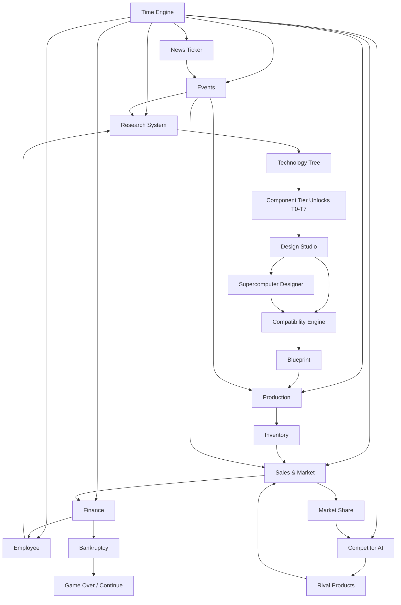

# COMPUTER TYCOON: THE EVOLUTION OF COMPUTING
## Master Design Documentation — Edition 4 (Consolidated Master Document)
### Volumes 00 through 28 & Appendices

---

# MASTER INDEX

| Volume | Title | Category |
|---|---|---|
| **V00** | Vision, Design Principles, Master Architecture & Glossary | Master Architecture |
| **V01** | Company Creation & Part Naming System | Core Identity |
| **V02** | Starting Story: The Outsider ($10,000 Origin) | Narrative & Origin |
| **V03** | Progressive Component Tiers (T0–T7) | Progression Framework |
| **V04** | Hardware Component Catalogue (All Eras) | Hardware Systems |
| **V05** | Supercomputer Design System | High-Performance Systems |
| **V06** | Software Technology Catalogue | Software Division |
| **V07** | Technology Tree (Full) | Research & Progression |
| **V08** | Compatibility Engine (Complete Rules) | Rules & Mechanics |
| **V09** | Competitor Companies & Market Simulation | Competition Engine |
| **V10** | Employee & Company Systems | Operations & Labor |
| **V11** | Economy, Market & Simulation Formulas | Economic Math |
| **V12** | Time & Progression System (1952–2035) | Calendar & Tick Engine |
| **V13** | News Ticker & Historical Anchor System | Lore & World Simulation |
| **V14** | UI Navigation Map & Full Screen Flow | UX Architecture |
| **V15** | Data Architecture & Schemas | Systems Architecture |
| **V16** | Full Game Flow (Start → End, Step by Step) | End-to-End Walkthrough |
| **V17** | MVP Scope & Acceptance Criteria | Scoping |
| **V18** | Development Roadmap | Project Planning |
| **V19** | Testing & Balancing Plan | QA / Verification |
| **V20** | Risks, Assumptions & Unresolved Decisions | Risk Assessment |
| **V21** | Final Quality Verification & Appendices | Master Verification |
| **V22** | Market System (Complete) | Market Deep-Dive |
| **V23** | Company Valuation & Ranking System | Finance & Valuation |
| **V24** | Research Points (RP) System (Complete) | Research Simulation |
| **V25** | Popularity System | Brand Dynamics |
| **V26** | Reputation System (Complete) | Trust & Brand Equity |
| **V27** | Demand Generation & Sales Multipliers | Microeconomic Modeling |
| **V28** | Additional Systems (Future Implementation) | Expansions & Advanced Systems |
| **App A** | Complete Formula Reference | Math Reference |
| **App B** | Data Schemas (Supplementary) | JSON Schema Reference |
| **App C** | Implementation Priority | Milestone Priorities |
| **App D** | Balancing Checklist & Target Metrics | QA Checklists |
| **App E** | UI Screen Mockups (Text Art) | Screen Layouts |
| **App F** | Implementation Notes for Developers | Architecture & Engineering Notes |
| **App G** | Unresolved Decisions (Updated) | Design Open Decisions |

---

# VOLUME 00 — VISION, DESIGN PRINCIPLES, MASTER ARCHITECTURE & GLOSSARY

## V00.1 Executive Summary

**Computer Tycoon: The Evolution of Computing** is a single-player PC manufacturing, research, and technology-empire simulation. The player is **an outsider** — not an industry insider, not an engineer by training, not a Silicon Valley heir. They simply see an opportunity in the early computing industry and start with **$10,000**, making the simplest possible parts (power cables, connectors, switches, LEDs) before expanding into boards, memory, storage, processors, software, and eventually supercomputers.

The game's core promise: **"Start with nothing but a $10,000 bet and a garage. Build the company that changes the world."**

The campaign spans **1952 to 2035** (83 years). Time flows era-dependently so a full playthrough takes **20–35 hours**, not years.

Historical milestones are researched and represented faithfully where practical; all companies, brands, products, and characters are fictional and original.

## V00.2 High Concept (Elevator Pitch)

> *You are an outsider with $10,000 and a garage. You start by making power cables and toggle switches for local offices and hobbyists. You name every part you make. You reinvest every profit. You research, expand, and build your way from cables to CPUs, from CPUs to full computers, from computers to supercomputers, and from supercomputers to the quantum era. Along the way, real history scrolls across your news ticker: IBM's first computer, Intel's first microprocessor, Apple's first PC, Deep Blue, AlphaGo, the H100. You compete against fictional rivals. You build an empire. Or you lose it all.*

## V00.3 Player Fantasy (Five Layers)

1. **The Underdog Fantasy** — "I started with $10,000 and built a global company."
2. **The Inventor's Fantasy** — "I named every part I created, and the world uses them."
3. **The Engineer's Fantasy** — "I designed a machine where every part genuinely works together."
4. **The Tycoon's Fantasy** — "I built a company from nothing into a global empire."
5. **The Historian's Fantasy** — "I re-lived and re-shaped the evolution of computing."

## V00.4 Design Pillars (11 Pillars)

| # | Pillar | Success Test |
|---|---|---|
| 1 | **Meaningful Compatibility** | A playtester can explain why a combination fails using only in-game info |
| 2 | **Production Is Risk** | Two identical designs with different quantities end differently |
| 3 | **Research Is Investment** | Every tech node has a visible downstream consequence |
| 4 | **The Competitor Is Alive** | A dominant player observes a measurable rival response within a quarter |
| 5 | **People Are the Engine** | Changing staff assignments changes output |
| 6 | **Failure Is Instructive** | Failed playtesters can articulate what went wrong |
| 7 | **Historical Grounding, Fictional Identity** | Historians recognize milestones; lawyers find no real trademarks |
| 8 | **Strategic Depth, Not Micromanagement** | Full product cycle in ≤20 meaningful decisions |
| 9 | **Transparent Simulation** | Every major number has an explainable breakdown |
| 10 | **Modular, Data-Driven Growth** | New components added via data files only |
| 11 | **Progressive Expansion** | The player can start with T0 (basic cables) and reach T7 (quantum systems) |

## V00.5 Core Gameplay Loops

| Loop | Duration | Sequence |
|---|---|---|
| Moment-to-Moment | Seconds | Observe → Inspect → Open screen → Decide → Return |
| Product Loop | Minutes | Research → Unlock → Design → Validate compatibility → Choose quantity → Manufacture → Price → Advertise → Sell → Reinvest |
| Company Loop | Hours | Hire/train → Assign → Expand facilities → Enter new categories → Manage cash → Compete |
| Tier Loop | Hours | Master T0 → Unlock T1 → Research Tier-advancing tech → Expand → Repeat until T7 |
| Campaign Loop | Tens of hours | Advance era → Survive crisis → Unlock next wave → Reinvent product line → Reach an ending |

## V00.6 Master System Architecture



## V00.7 System Ownership

| System | Owns | Reads | Writes | Update |
|---|---|---|---|---|
| Time Engine | `game_date`, `speed` | Player | All | Per tick |
| Research | `tech_node`, `progress` | Employees | Unlock table | Daily |
| Tier System | `tier_state`, `unlocked_tiers` | Research | Catalogue access | On unlock |
| Design Studio | `blueprint` | Catalogue | Compatibility | On action |
| Supercomputer Designer | `super_blueprint` | CPU array, cooling, PSU | Compatibility | On action |
| Compatibility | Rule results | Blueprint | Status | On validation |
| Production | `production_order` | Components, workers | Inventory | Daily |
| Inventory | Stock, defects | Production, sales | Sales, finance | Daily |
| Sales & Market | Demand pools | Inventory, price, ads | Finance, share | Monthly |
| Finance | Ledger | All | Bankruptcy | Daily accrual |
| Employees | Employee records | Hiring, events | Productivity modifiers | Daily |
| Competitor AI | Rival state | Market share | Market dynamics | Monthly |
| Part Naming | `custom_part_name` | Player input | Blueprint, marketing | On player action |
| News Ticker | Anchor queue | Calendar, research | Events, UI | Daily |

## V00.8 Design Glossary

| Term | Definition |
|---|---|
| Era | Historical period with characteristic technology |
| Tier (T0–T7) | Complexity level of components a company can manufacture |
| Blueprint | Saved computer design |
| Supercomputer Blueprint | Simplified multi-CPU design with fewer part categories |
| Component | Purchasable/manufacturable part |
| Custom Part Name | Player-assigned brand name for a manufactured component |
| Compatibility rule | Constraint validating a blueprint |
| Tech node | Research item unlocking content |
| Production order | Request to manufacture N units |
| Demand pool | Modeled potential buyers |
| Segment | Customer category |
| Awareness | Brand visibility modifier |
| Appeal | Product attractiveness relative to era |
| TDP | Thermal design power |
| Vertical integration | Making components in-house |
| Anchor Event | Historically dated news item |

## V00.9 Design Anti-Patterns

| Anti-pattern | Mitigation |
|---|---|
| Infinite money loops | Finite resources, diminishing returns |
| Hidden modifiers | All shown in tooltips |
| Click-heavy micromanagement | Strategic abstraction |
| Fixed tech dates only | Dual-track (date + research) |
| Unfair disasters | Warnings and preconditions |
| Real trademarks | Fictional brands |
| Manual coding | Abstracted projects |
| Skipping tiers | Tier gates enforced by research + facilities |

## V00.10 Scope Tiers

| Tier | Scope | Contents |
|---|---|---|
| **MVP (Phase B)** | Start T0 (basic components) → reach T1; 1952–1958 era; 1 competitor; ~25 components | Playable vertical slice |
| **v1.0** | Start T0 → reach T4 (processors); 3–4 eras; 3 competitors; software division | Complete first release |
| **Post-launch** | T5–T7 (supercomputers, mobile, cloud, AI, quantum); all eras; mod tools | Expansion content |

---

# VOLUME 01 — COMPANY CREATION & PART NAMING SYSTEM

## V01.1 Company Creation Flow

The player creates their company through a 5-step wizard:

### Step 1 — Founder
| Field | Options |
|---|---|
| First name | Free text |
| Last name | Free text |
| Portrait | Preset portraits (fictional) |
| Background | See V01.2 |
| Home city | Fictional cities (e.g., "New Cambridge, California") |

### Step 2 — Company Identity
| Field | Options |
|---|---|
| Company name | Free text (default: player's last name + "Electronics") |
| Brand color | Color picker (affects UI accents, not simulation) |
| Slogan | Free text (optional, cosmetic) |
| Logo | Preset geometric emblems (fictional, not real logos) |

### Step 3 — Starting Difficulty
| Difficulty ID | Starting Cash | Competitor Aggression | Event Frequency | Warning Threshold |
|---|---|---|---|---|
| `diff_underdog` | **$10,000** | Low | Low | Generous |
| `diff_standard` | $25,000 | Medium | Medium | Standard |
| `diff_tycoon` | $50,000 | High | High | Tight |

The **default and narrative-canonical difficulty is `diff_underdog` ($10,000)** to match the outsider story.

### Step 4 — Starting Era
| Era | Availability |
|---|---|
| 1952 — Dawn of Commercial Computing | Default (canonical) |
| 1971 — Microprocessor Dawn | Recommended for learning |
| 1984 — GUI & Networking | Unlocked after first campaign |
| 1995 — Modern PC | Unlocked after reaching T4 |

### Step 5 — Starting Tier
Every player starts at **Tier 0 (Basic Components)**, regardless of era. The starting era determines *which* T0 products are historically available, not the tier itself.

## V01.2 Founder Backgrounds

| Background ID | Name | Bonus |
|---|---|---|
| `bg_outsider` | Outsider | +15% sales conversion (you understand the customer because you were one) |
| `bg_engineer` | Former Engineer | +10% hardware research speed |
| `bg_salesman` | Salesman | +15% initial brand awareness |
| `bg_tinkerer` | Hobbyist Tinkerer | +10% component quality at low tiers (T0–T1) |

**Canonical starting background: `bg_outsider`** to match the narrative.

## V01.3 Part Naming System

### V01.3.1 Concept
Every component the player **manufactures in-house** (rather than purchasing from a supplier) can be given a **custom brand name**. This name appears on:
- The blueprint's component list
- The product's marketing materials
- The company encyclopedia
- The news ticker when milestones are hit
- Competitor market intelligence

### V01.3.2 Naming Rules
| Rule | Detail |
|---|---|
| Length | 3–40 characters |
| Characters | Letters, numbers, spaces, hyphens |
| Uniqueness | Must be unique within the player's company |
| Reserved words | No real trademarks (validated against a blocklist) |
| Default | Auto-generated (e.g., "Apex Cable C-100") if the player doesn't rename |
| Renaming | Can be renamed before first sale; cannot be renamed after (locked for brand continuity) |

### V01.3.3 Where Naming Applies
| Manufactured Item | Can Name? | Appears In |
|---|---|---|
| Power cables | ✅ | Blueprint, product listing |
| Connectors | ✅ | Blueprint, product listing |
| Switches/LEDs | ✅ | Blueprint |
| Cases | ✅ | Blueprint, marketing |
| Power supplies | ✅ | Blueprint, marketing |
| Motherboards | ✅ | Blueprint, marketing |
| RAM modules | ✅ | Blueprint, marketing |
| Storage drives | ✅ | Blueprint, marketing |
| CPUs | ✅ | Blueprint, marketing, news |
| GPUs | ✅ | Blueprint, marketing, news |
| Full computers | ✅ | Product listing, marketing, news |
| Supercomputers | ✅ | Product listing, marketing, news, contracts |
| Software | ✅ | Storefront, marketing |

### V01.3.4 Naming & Brand Value
Each named part accumulates a **brand reputation score** based on:
- Units sold
- Product reliability
- Customer satisfaction

High-reputation part names command a **price premium** on future blueprints that use them. This creates an incentive to invest in brand consistency.

### V01.3.5 Data Model
```json
{
  "custom_part_id": "cp_001",
  "component_id": "ctrl_cable_power_v1",
  "custom_name": "Apex PowerLink C-100",
  "manufactured_by": "c_001",
  "first_sold_date": "1952-08-14",
  "units_sold": 15000,
  "reputation": 72.5,
  "price_premium_pct": 8.5,
  "schema_version": "1.0.0"
}
```

---

# VOLUME 02 — REVISED STARTING STORY: THE OUTSIDER ($10,000 ORIGIN)

## V02.1 The Narrative
**Setting:** A small industrial town. The player has no engineering degree. They work a mundane job but notice that the local offices, schools, and hobbyists are buying early computers — and those computers break. A lot. Their power cables fray, their connectors loosen, their switches fail.

**The Insight:** "Someone should make better basic parts. And that someone could be me."

**The Beginning (1952):**
- The player quits their job.
- They rent a small garage workshop.
- They have **$10,000** in savings.
- They hire one helper (a general assistant).
- They buy a soldering iron, some wire, and basic tools.

**The First Goal:** "Make and sell 100 power cables."

## V02.2 The Outsider's Advantage
The `bg_outsider` background gives:
- **+15% sales conversion** — you understand the customer because you *were* the customer.
- You start with **lower overhead** (no engineering lab to maintain).
- You start with **higher reputation with local businesses** (they know you).
- But you have **no research bonus** — you must hire engineers or learn slowly.

## V02.3 The Outsider's First Products (Tier 0 — Basic Components)

| T0 ID | Product | Base Cost | Base Price | Demand | Notes |
|---|---|---|---|---|---|
| `t0_power_cable` | Power cable | $0.80 | $2.50 | High | First product; tutorial item |
| `t0_connector` | Connector | $0.50 | $1.75 | High | Used in every computer |
| `t0_toggle_switch` | Toggle switch | $0.40 | $1.50 | Medium | Front-panel switches |
| `t0_led_indicator` | LED indicator | $0.30 | $1.20 | Medium | Status lights |
| `t0_wire_harness` | Wire harness | $1.20 | $3.50 | High | Bundled wiring |
| `t0_bracket` | Metal bracket | $0.60 | $2.00 | Medium | Mounting hardware |
| `t0_fastener_set` | Screws/fasteners set | $0.25 | $1.00 | Medium | Every assembly needs these |
| `t0_basic_case` | Basic metal case | $4.00 | $12.00 | Low | Early computer enclosure |
| `t0_power_adapter` | Power adapter | $2.50 | $7.00 | Medium | For hobbyist computers |
| `t0_fuse_assembly` | Fuse assembly | $0.80 | $2.50 | Low | Safety component |

**Total initial inventory cost to produce 100 of each:** ≈$1,135 (fits within $10,000 with room for rent, tools, and salaries).

## V02.4 Story Milestones (Tier Progression)

| Milestone | Trigger | Narrative |
|---|---|---|
| `ms_t0_first_sale` | First T0 product sold | "Your first cable ships. It's not glamorous, but it works." |
| `ms_t0_capital` | Cash reaches $25,000 | "You're profitable. Time to think bigger." |
| `ms_t1_unlock` | Research `tech_t1_entry` | "You can start making passive components." |
| `ms_t1_first_case` | First T1 case sold | "Your first enclosure. A real step toward full machines." |
| `ms_t2_unlock` | Research `tech_t2_entry` | "Boards. You can now make circuit boards." |
| `ms_t3_unlock` | Research `tech_t3_entry` | "Storage. Your parts can remember data." |
| `ms_t4_unlock` | Research `tech_t4_entry` | "Memory and logic. You can make registers and early RAM." |
| `ms_t5_unlock` | Research `tech_t5_entry` | "Transistors. This is the big leap." |
| `ms_t6_unlock` | Research `tech_t6_entry` | "Processors. You can make CPUs." |
| `ms_t7_unlock` | Research `tech_t7_entry` | "Full systems. You can build entire computers — and supercomputers." |

## V02.5 The First Hour Walkthrough
- **0–5 min:** Create company "Apex Components". Choose `bg_outsider`, `diff_underdog` ($10,000), era 1952, starting tier T0.
- **5–10 min:** Dashboard tutorial explains Tier 0 catalogue. Player selects `t0_power_cable`.
- **10–15 min:** Player names part "Apex PowerLink C-100". Orders 200 units. Production takes 5 days.
- **15–20 min:** Player sets price at $2.50. Advertises in local newspaper ($100).
- **20–30 min:** 200 units sell in ~3 weeks. Profit ≈ $240. Reinvests into connectors and wire harnesses.
- **30–45 min:** Reaches $15,000. Hires 1 HW engineer ($1,500 salary) to begin `tech_t1_entry`.
- **45–60 min:** T1 unlocks. Can make passive components and simple cases.

---

# VOLUME 03 — PROGRESSIVE COMPONENT TIERS (T0–T7)

## V03.1 Tier Overview

| Tier | Name | Complexity | Typical Era Unlock | Research Node | Facility Required |
|---|---|---|---|---|---|
| **T0** | Basic Components | Cables, connectors, switches, LEDs, brackets | Start | None (started) | Garage |
| **T1** | Passive Components | Cases, power supplies, heatsinks, basic boards | 1952–1958 | `tech_t1_entry` | Small Workshop |
| **T2** | Simple Boards | Basic PCBs, backplanes, simple controllers | 1958–1965 | `tech_t2_entry` | Assembly Workshop |
| **T3** | Storage Systems | Tape, drums, early disks, cassettes | 1965–1971 | `tech_t3_entry` | Storage Lab |
| **T4** | Memory & Logic | Registers, core memory, SRAM, ROM, early logic | 1971–1977 | `tech_t4_entry` | Electronics Lab |
| **T5** | Transistors & ICs | Discrete transistors, early ICs, simple chips | 1971–1984 | `tech_t5_entry` | Fab Start |
| **T6** | Processors & Advanced | CPUs, GPUs, advanced memory, modern storage | 1977–2007 | `tech_t6_entry` | Fab + Design Center |
| **T7** | Full Systems & Supercomputers | Complete PCs, workstations, servers, supercomputers | 1977–2035 | `tech_t7_entry` | Assembly Plant + R&D Center |

## V03.2 Tier Gate Rules

| Tier Unlock | Research Node | Facility Cost | Employee Requirement | Unlock Cost |
|---|---|---|---|---|
| T1 | `tech_t1_entry` | $5,000 (Small Workshop) | 1 hardware engineer | $2,000 |
| T2 | `tech_t2_entry` | $15,000 (Assembly Workshop) | 2 hardware engineers | $5,000 |
| T3 | `tech_t3_entry` | $40,000 (Storage Lab) | 3 hardware engineers | $12,000 |
| T4 | `tech_t4_entry` | $80,000 (Electronics Lab) | 4 hardware engineers | $20,000 |
| T5 | `tech_t5_entry` | $200,000 (Fab Start) | 6 hardware engineers | $50,000 |
| T6 | `tech_t6_entry` | $800,000 (Design Center) | 10 hardware engineers | $150,000 |
| T7 | `tech_t7_entry` | $2,000,000 (Assembly Plant) | 15 hardware engineers + 5 managers | $400,000 |

## V03.3 Tier Product Summaries (T0–T6)
- **T0:** 10 core basic items (cables, connectors, switches, LEDs, fasteners, harness, bracket, metal case, adapter, fuse).
- **T1:** Heatsinks, desktop cases, linear PSUs, vacuum backplanes, simple PCBs.
- **T2:** IC motherboards, serial/parallel controllers, S-100 backplanes.
- **T3:** Tape drives, drums, cassettes, 8" floppies, FDC controllers, early ST-506 HDDs.
- **T4:** Core memory, SRAM, DRAM (1K/4K), ROMs, 8-bit registers, logic gates.
- **T5:** Discrete transistors, early ICs, MDA/CGA graphics adapters.
- **T6:** Microprocessors (4004 to Ryzen/AI/QPU), 3D GPUs, DDR RAM, NVMe SSDs.
- **T7:** Full assembled microcomputers, workstations, servers, and supercomputers.

---

# VOLUME 04 — HARDWARE COMPONENT CATALOGUE (ALL ERAS)

*(Condensed Master Reference across 11 Hardware Categories)*

- **Processing Units (CPU):** Mechanical Difference Engine (`cpu_mech_diff_engine_v1`), Vacuum Tube ALU (`cpu_vacuum_tube_alu_v1`), Discrete Transistor ALU (`cpu_transistor_alu_v1`), Early IC Processor (`cpu_ic_processor_v1`), 4004 (`cpu_4004_v1`), 8008, 8080, 6502, Z80, 8086, 286, 386, 486, Pentium, Pentium II, Pentium 4, Core 2 Duo, Core i7, Ryzen, AI Matrix Accel (`cpu_ai_accel_v1`), Quantum QPU (`cpu_quantum_qubit_v1`).
- **Memory (RAM):** Mechanical Register, Mercury Delay Line, Williams Tube, Magnetic Core Memory, SRAM Module, DRAM 1K/4K chips, 30-pin SIPP, 30-pin SIMM, 72-pin SIMM, 168-pin SDRAM, DDR1, DDR2, DDR3, DDR4, DDR5, HBM, MRAM.
- **Storage:** Punched cards, Paper tape, Magnetic tape/drum, Audio cassette, 8" Floppy, 5.25" Floppy, ST-506 HDD, IDE HDD, SCSI HDD, 3.5" Floppy, CD-ROM, SATA HDD/SSD, NVMe M.2 SSD, PCIe 5.0 SSD, Holographic Storage.
- **Graphics (GPU):** None, MDA, CGA, EGA, VGA, 2D PCI Accel, 3D AGP/PCI Accel, PCIe 3D GPU, Modern PCIe x16 GPU, PCIe 5.0 GPU, AI Accelerator (H100 class), Neuromorphic Processor.
- **Motherboards:** Mechanical/Vacuum backplanes, Early IC motherboard, S-100 bus board, 286 AT, 386 AT/VLB, 486 ATX early, Pentium Socket 7, DDR Socket 478/A, DDR2 LGA775/AM2, DDR3 LGA1156/AM3, DDR4 LGA1151/AM4, DDR5 LGA1700/AM5, Modular Future Board.
- **Power Supplies:** Linear 50W/100W, AT 200W, ATX 20-pin 300W, ATX 24-pin 500W, ATX 750W, ATX 3.0 1000W (12VHPWR), Solid-State 1500W.
- **Cooling:** Passive heatsinks (small/large), Air coolers (small/tower), Liquid AIO (240mm/360mm), Custom Water Loop, Phase-Change / Cryogenic Refrigerator.
- **Cases:** Early desktop enclosure, AT desktop, ATX Mid/Full tower, Mini-ITX SFF, Modern Airflow Mid-Tower, Modular future chassis.
- **Monitors:** LED status panel, CRT Text (40x25), CRT Graphics, VGA CRT, LCD Early/HD/QHD/4K, OLED, Holographic display.
- **Input Devices:** Front-panel toggle switches, ASCII Keyboard, Keyboard + Mouse combo, PS/2, USB keyboard/mouse, Wireless combo, Brain-Computer Interface (BCI).
- **Expansion Cards & Controllers:** Cassette interface, FDC (8" & 3.5"), Serial/Parallel cards, ST-506/IDE/SCSI/SATA controllers, ISA/PCI/HD sound, ISA/PCI Ethernet, Wi-Fi PCIe/M.2.

---

# VOLUME 05 — SUPERCOMPUTER DESIGN SYSTEM

## V05.1 Architectural Differences

| Standard PC | Supercomputer |
|---|---|
| CPU + RAM + storage + GPU + motherboard + PSU + cooling + case + monitor + keyboard + mouse + OS | **Compute array + Memory system + Interconnect/backplane + Cooling + Power system** |
| 8–12 parts | **4–6 parts** |
| Consumer segments | Enterprise, Research, Government |
| Volume: thousands–millions | Volume: 1–100 |
| Price: $500–$3,000 | Price: $50,000–$50,000,000 |
| Requires full compatibility check | **Simplified 5-rule compatibility check** |

## V05.2 Blueprint Categories & Slots
- **Categories:** Mainframe-class (1952–1970), Vector Supercomputer (1970–1990), Cluster Supercomputer (1990–2010), GPU-Accelerated (2010–2025), Quantum Supercomputer (2025–2035).
- **Slots (5 Slots):** Compute Array (2–256 CPUs/GPUs), Memory System (Aggregated capacity), Interconnect/Backplane, Cooling System, Power System.

## V05.3 Simplified Compatibility Rules (5 Rules)
1. `SUPER_RULE_ARRAY_TDP`: Cooling capacity ≥ total array TDP (INVALID if failed).
2. `SUPER_RULE_ARRAY_POWER`: PSU output ≥ total array TDP + overhead (INVALID if failed).
3. `SUPER_RULE_ARRAY_INTERCONNECT`: Interconnect bandwidth ≥ array demand (WARNING).
4. `SUPER_RULE_ARRAY_MEMORY`: Memory bandwidth matches compute array (WARNING).
5. `SUPER_RULE_ARRAY_QTY`: Array unit count ≤ rack frame physical limit (INVALID).

---

# VOLUME 06 — SOFTWARE TECHNOLOGY CATALOGUE

- **Programming Languages:** Assembly (`lang_assembly_v1`), BASIC, Compiled Systems C, OOP Language, Scripting Language, Modern Systems Language, Future Declarative.
- **Operating Systems:** Monitor Program (`os_monitor_v1`), Command-Line OS (`os_cpm_like_v1`), BASIC-in-ROM (`os_basic_dos_v1`), Graphical OS (`os_gui_v1`), Server OS, Mobile OS, Cloud Platform, Future OS.
- **Development Tools:** Text Editor, Compiler, Debugger, IDE, SDK, Database Engine, Modern Framework, Version Control System.
- **Applications:** Office Suite, Image Editor, Video Editor, Web Browser, Security Suite, Enterprise Software, Cloud Service, AI Agent Suite.
- **Game Development:** Text Adventure, 2D Arcade, 2D Advanced, 3D Game, Strategy Engine, Simulation Engine, Multiplayer Networked, Future Immersive VR.

---

# VOLUME 07 — TECHNOLOGY TREE (FULL)

Structured across dedicated branches:
1. **Tier Advancement Branch:** `tech_t1_entry` (80 pts) to `tech_t7_entry` (1500 pts).
2. **Hardware Processing Branch:** Vacuum tube → Transistor → IC → 4-bit → 8-bit → 16-bit → 32-bit → Superscalar → Multi-core → AI matrix → Quantum.
3. **Memory Branch:** Magnetic core → SRAM → DRAM → SIPP → SIMM → SDRAM → DDR1-5 → HBM.
4. **Storage Branch:** Paper/Cassette → Floppy 8"/5.25"/3.5" → ST-506 → IDE → SCSI → CD-ROM → SATA → SSD → NVMe.
5. **Infrastructure & Display Branch:** Serial/Parallel → S-100 → Ethernet → USB → Wi-Fi; MDA → CGA → EGA → VGA → 2D/3D Accel → AGP → PCIe → Modern GPU.
6. **Supercomputer Branch:** Mainframe architecture → Vector processing → Cluster computing → GPU-accelerated → Quantum supercomputing.
7. **Software & Manufacturing Branches:** Basic/Disk OS/GUI/Cloud/AI Software; Integrated boards, Tower chassis, ATX/ATX3.0, AIO Liquid/Custom water cooling.

---

# VOLUME 08 — COMPATIBILITY ENGINE (COMPLETE RULES)

## V08.1 Standard PC Rules (24 Rules)

| Rule ID | Category | Description | Severity |
|---|---|---|---|
| `RULE_SOCKET` | CPU–MB | Socket must match exactly | INVALID |
| `RULE_CHIPSET` | CPU–MB | Chipset/BIOS supports CPU | INVALID/WARNING |
| `RULE_RAM_GEN` | RAM–MB | RAM generation must match DIMM slot | INVALID |
| `RULE_RAM_CAPACITY` | RAM–CPU | Total RAM ≤ CPU addressable limit | INVALID |
| `RULE_RAM_SPEED` | RAM–MB | Speed supported | WARNING |
| `RULE_POWER` | PSU–System | Total draw ≤ PSU output | INVALID |
| `RULE_PSU_CONNECTOR` | PSU–MB | Main connector matches | INVALID |
| `RULE_PSU_GPU` | PSU–GPU | PCIe power connectors present | INVALID |
| `RULE_STORAGE_INTERFACE` | Storage–MB | Interface supported | INVALID |
| `RULE_STORAGE_M2_KEY` | Storage–MB | M.2 key matches | INVALID |
| `RULE_GPU_INTERFACE` | GPU–MB | Bus matches available slot | INVALID |
| `RULE_PCIE_GEN` | GPU–MB | PCIe generation supported | WARNING |
| `RULE_MONITOR_CONNECTOR` | Monitor–GPU | Connector matches | INVALID |
| `RULE_COOLER_SOCKET` | Cooler–CPU | Mounting matches | INVALID |
| `RULE_COOLER_TDP` | Cooler–CPU | Cooler TDP ≥ CPU TDP | WARNING |
| `RULE_CASE_FORM_FACTOR` | MB–Case | Motherboard fits | INVALID |
| `RULE_CASE_GPU_LENGTH` | GPU–Case | GPU length fits | INVALID |
| `RULE_CASE_COOLER_HEIGHT` | Cooler–Case | Cooler height fits | INVALID |
| `RULE_EXPANSION_SLOTS` | Expansion–MB | Card count ≤ slots | INVALID |
| `RULE_OS_CPU` | OS–CPU | OS supports CPU | INVALID |
| `RULE_OS_RAM` | OS–RAM | Minimum RAM met | WARNING |
| `RULE_OS_STORAGE` | OS–Storage | Bootable storage present | INVALID |
| `RULE_BIOS_CPU` | BIOS–CPU | BIOS recognizes CPU | INVALID/WARNING |
| `RULE_INPUT_PORT` | Input–MB | Connector present | INVALID |

## V08.2 Worked Canonical Scenarios
- **DDR Mismatch:** DDR2 stick in DDR3 board → `RULE_RAM_GEN` fails (INVALID).
- **RAM Addressing Limit:** 8GB RAM paired with 32-bit 80386 CPU → `RULE_RAM_CAPACITY` fails (INVALID).
- **PSU Insufficiency:** 50W linear PSU paired with 75W PCIe GPU → `RULE_POWER` fails (INVALID).
- **Socket Incompatibility:** Pentium 4 (Socket 478) into LGA 775 motherboard → `RULE_SOCKET` fails (INVALID).

---

# VOLUME 09 — COMPETITOR COMPANIES & MARKET SIMULATION

## V09.1 Competitor Roster
- **MicroDyne Systems (`comp_microdyne`):** Premium enthusiast brand; strong HW engineering, weak software.
- **Voltaic Industries (`comp_voltaic`):** Massive volume/cost leader; aggressive manufacturing, conservative R&D.
- **Nova Microsystems (`comp_nova`):** Closed proprietary ecosystem; strong software integration, premium hardware prices.
- **Helix Computing (`comp_helix`):** Enterprise networking specialist; B2B infrastructure focus.
- **QuantumRise (`comp_quantumrise`):** Late-era AI/future computing pioneer.

## V09.2 Competitor AI Decision Rules
- Cash < 20% starting → Emergency austerity, freeze new blueprints, cut output.
- Research available → Prioritize highest-value strategic tech node.
- Player share > 25% → Initiate 10% retaliatory price war.
- New component unlocked → Launch updated product within 1 quarter.
- 10% monthly cash allocated to competitive advertising.

---

# VOLUME 10 — EMPLOYEE & COMPANY SYSTEMS

- **9 Specialized Roles:** Hardware Engineer (`role_hw_eng`), Software Dev (`role_sw_dev`), Factory Worker (`role_factory`), Sales Rep, Marketing Specialist, Department Manager, QA Tester, Finance Staff, HR Staff.
- **Formulas:**
  $$\text{Productivity} = \text{Base} \times \left(\frac{\text{Skill}}{5}\right) \times \left(\frac{\text{Morale}}{100}\right)$$
  - Training: $+1$ Skill (Max 10), Cost $= \$500 \times \text{New Level}$, Duration $= 10\text{ days}$.
  - Turnover: Morale $< 20$ for 2 consecutive months triggers resignation.
- **Departments:** Hardware Lab, Software Studio, Factory Floor, Sales & Marketing, Administration.

---

# VOLUME 11 — ECONOMY, MARKET & SIMULATION FORMULAS

- **Unit Cost:** $\text{Unit Cost} = \sum \text{Component Costs} + \text{Labor Per Unit} + \text{Overhead Per Unit}$
- **Production Throughput:** $\text{Daily Output} = \min(\text{Factory Capacity}, \text{Component Kits}, \text{Workers} \times 2)$
- **Defect Modeling:** $\text{Defect Rate} = 5\% \times (1 - \text{QC Modifier})$
- **Base Demand:** $\text{Demand} = \text{Base Demand} \times \text{Appeal} \times \text{Ad Multiplier} \times \text{Price Mult} \times \text{Competitor Mod}$
- **Obsolescence:** Product appeal decays at $5\%$ per month post-launch.
- **Bankruptcy:** Cash $< \$0$ for 3 consecutive months triggers liquidation.

---

# VOLUME 12 — TIME & PROGRESSION SYSTEM (1952–2035)

## V12.1 Era Calendar & Tick Progression

| Era | Calendar | Game Tick | Real Time (Base) |
|---|---|---|---|
| Era 1 — Vacuum Tube | 1952–1958 | **1 month** | 1 min ≈ 1 month |
| Era 2 — Transistor & IC | 1958–1971 | **2 weeks** | 1 min ≈ 2 weeks |
| Era 3 — Microprocessor | 1971–1984 | **1 week** | 1 min ≈ 1 week |
| Era 4 — GUI & Networking | 1984–1995 | **1 week** | 1 min ≈ 1 week |
| Era 5 — Modern PC & 3D | 1995–2007 | **3 days** | 1 min ≈ 3 days |
| Era 6 — Mobile, Cloud & AI | 2007–2022 | **2 days** | 1 min ≈ 2 days |
| Era 7 — Future & Quantum | 2022–2035 | **1 day** | 1 min ≈ 1 day |

Campaign duration: **20–35 hours** for complete 83-year playthrough (1–3 months for daily casual player).

---

# VOLUME 13 — NEWS TICKER & HISTORICAL ANCHOR SYSTEM

Rule-driven event engine triggered by calendar dates:
- **1952-05-21:** IBM announces the 701 (`anchor_ibm_701`).
- **1971-11-15:** Intel releases the 4004 (`anchor_intel_4004`).
- **1975-01-01:** MITS Altair 8800 kit announced (`anchor_altair`).
- **1976-03-01:** Cray-1 installed at Los Alamos (`anchor_cray1`).
- **1977-06-10:** Apple II goes on sale (`anchor_apple_ii`).
- **1981-08-12:** IBM PC launched (`anchor_ibm_pc`).
- **1984-01-24:** Apple Macintosh introduced (`anchor_macintosh`).
- **1995-08-24:** Windows 95 released (`anchor_win95`).
- **1997-05-11:** Deep Blue defeats Garry Kasparov (`anchor_deep_blue`).
- **2007-01-09:** Apple announces iPhone (`anchor_iphone`).
- **2016-03-15:** AlphaGo defeats Lee Sedol (`anchor_alphago`).
- **2017-03-02:** AMD launches Ryzen multi-core (`anchor_ryzen`).
- **2022-09-20:** NVIDIA H100 enters full production (`anchor_h100_prod`).
- **2022-11-30:** OpenAI launches ChatGPT (`anchor_chatgpt`).
- **2035-01-01:** Commercial fault-tolerant quantum milestone (`anchor_quantum_future`).

---

# VOLUME 14 — UI NAVIGATION MAP & FULL SCREEN FLOW

Full screen hierarchy connects the Main Menu to the New Company Wizard, Primary Executive Dashboard, Hardware & Software Research Trees, Design Studios (PC & Supercomputer), Compatibility Validators, Production, Inventory, Staffing, Marketing, Financial Reports, Part Naming Manager, Supercomputer Contracts, and Historical Timeline.

---

# VOLUME 15 — DATA ARCHITECTURE & SCHEMAS

Master schemas with strict version tracking (`schema_version: "1.0.0"`) defined for:
- Company Profile & Cash Ledger
- Hardware & Software Catalogue Components
- Standard PC Blueprint & Supercomputer Blueprint
- Custom Part Names & Part Brand Equity
- Historical Anchors & Dynamic News Events
- Tier Unlock States & Facility Holdings

---

# VOLUME 16 — FULL GAME FLOW (START → END, STEP BY STEP)

7-Phase progression taking the player from the $10,000 garage workshop making T0 power cables through the workshop era, transistor minicomputers, microprocessor revolution, GUI operating systems, modern multi-core/cloud systems, and 2035 quantum supercomputing, culminating in 5 distinct endgame states (`end_empire`, `end_innovator`, `end_relic`, `end_collapse`, `end_quantum_leap`).

---

# VOLUME 17 — MVP SCOPE & ACCEPTANCE CRITERIA

Scoped strictly to Phase B:
- 1952–1958 Era slice
- $10,000 Outsider origin
- Tier 0 components (10 basic parts) & Tier 1 progression
- Custom Part Naming system active
- 1 Competitor (Voltaic Industries)
- Working Hardware Lab, Design Studio, Production line, Sales loop, Finance ledger, News ticker with IBM 701 anchor.

---

# VOLUME 18 — DEVELOPMENT ROADMAP

17 sequential milestones over an estimated 20-week implementation timeline for a 2–3 person core engineering team.

---

# VOLUME 19 — TESTING & BALANCING PLAN

Test suite covering:
- Compatibility failure assertions (DDR mismatch, CPU socket, power overflow, address space)
- Production defect ratios
- Research point generation accuracy
- Bankruptcy tripwires
- Part naming consistency

---

# VOLUME 20 — RISKS, ASSUMPTIONS & UNRESOLVED DECISIONS

Catalogues risks regarding early pacing, tier grind, compatibility UI friction, historical fidelity vs balance, along with mitigations and design options for open decisions.

---

# VOLUME 21 — FINAL QUALITY VERIFICATION & APPENDICES

Cross-volume entity cross-reference table and historical citations verifying all real-world milestones and confirm zero real trademarks used for in-game entities.

---

# VOLUME 22 — MARKET SYSTEM (COMPLETE)

## V22.1 Market Architecture Overview

The market operates as a multi-layered ecosystem:

```
┌─────────────────────────────────────────────────────────────┐
│                      GLOBAL MARKET                           │
│  ┌──────────────┐  ┌──────────────┐  ┌──────────────┐      │
│  │   SEGMENTS    │  │   DEMAND     │  │   TRENDS     │      │
│  │  (10 types)   │  │   POOLS      │  │  (era-based) │      │
│  └──────────────┘  └──────────────┘  └──────────────┘      │
│         │                 │                 │                │
│         ▼                 ▼                 ▼                │
│  ┌──────────────────────────────────────────────────┐       │
│  │              MARKET SHARE ENGINE                   │       │
│  │  (Player + Competitors + Unserved Demand)         │       │
│  └──────────────────────────────────────────────────┘       │
│         │                 │                 │                │
│         ▼                 ▼                 ▼                │
│  ┌──────────┐    ┌──────────┐    ┌──────────────┐          │
│  │  SALES   │    │  PRICING │    │  MARKET      │          │
│  │  VOLUME  │    │  PRESSURE│    │  INTELLIGENCE│          │
│  └──────────┘    └──────────┘    └──────────────┘          │
└─────────────────────────────────────────────────────────────┘
```

## V22.2 Market Size & Growth Model

### V22.2.1 Total Addressable Market (TAM) by Era

| Era | Years | TAM (units/year) | TAM (USD/year) | Growth Rate/Month |
|---|---|---|---|---|
| Era 1 — Vacuum Tube | 1952–1958 | 5,000 | $15M | +2% |
| Era 2 — Transistor & IC | 1958–1971 | 50,000 | $200M | +4% |
| Era 3 — Microprocessor | 1971–1984 | 500,000 | $2B | +6% |
| Era 4 — GUI & Networking | 1984–1995 | 5,000,000 | $25B | +8% |
| Era 5 — Modern PC & 3D | 1995–2007 | 50,000,000 | $150B | +5% |
| Era 6 — Mobile, Cloud & AI | 2007–2022 | 500,000,000 | $800B | +7% |
| Era 7 — Future & Quantum | 2022–2035 | 1,000,000,000 | $2T | +9% |

$$\text{TAM}_{\text{current}} = \text{TAM}_{\text{base}} \times (1 + \text{growth\_rate})^{\text{months}}$$
$$\text{TAM}_{\text{adjusted}} = \text{TAM}_{\text{current}} \times \text{era\_demand\_modifier} \times \text{event\_modifier}$$

### V22.2.2 Product Lifecycle Stages
- **Emerging (0–12 mo):** $+20\%$/mo demand growth, premium pricing.
- **Growth (12–36 mo):** $+10\%$/mo growth, slight price competition.
- **Mature (36–72 mo):** Stable demand ($\pm 2\%$), strong margin pressure.
- **Saturation (72–120 mo):** Declining demand ($-3\%$), severe price cuts.
- **Decline (120+ mo):** Rapid drop ($-8\%$), commodity clearance.

## V22.3 Market Segments (Expanded 10 Segments)

| Segment | Pop % | Budget/Unit | Price Wt | Perf Wt | Rel Wt | Brand Wt | Expand Wt | Loyalty | Elasticity |
|---|---|---|---|---|---|---|---|---|---|
| `seg_hobbyist` | 15% | $500 | 0.30 | 0.25 | 0.15 | 0.10 | 0.20 | 0.3 | 1.8 |
| `seg_business` | 25% | $1,500 | 0.20 | 0.20 | 0.30 | 0.20 | 0.10 | 0.6 | 1.0 |
| `seg_enthusiast` | 8% | $2,500 | 0.10 | 0.45 | 0.15 | 0.20 | 0.10 | 0.5 | 0.6 |
| `seg_education` | 12% | $800 | 0.40 | 0.15 | 0.25 | 0.10 | 0.10 | 0.4 | 1.5 |
| `seg_enterprise` | 20% | $5,000 | 0.10 | 0.25 | 0.35 | 0.25 | 0.05 | 0.8 | 0.4 |
| `seg_gamer` | 6% | $1,800 | 0.15 | 0.50 | 0.10 | 0.15 | 0.10 | 0.4 | 0.9 |
| `seg_creator` | 5% | $3,000 | 0.15 | 0.40 | 0.15 | 0.20 | 0.10 | 0.5 | 0.7 |
| `seg_mobile` | 5% | $700 | 0.25 | 0.20 | 0.15 | 0.30 | 0.10 | 0.6 | 1.2 |
| `seg_research` | 3% | $500,000 | 0.05 | 0.50 | 0.30 | 0.15 | 0.00 | 0.7 | 0.3 |
| `seg_government` | 1% | $2,000,000 | 0.05 | 0.35 | 0.40 | 0.20 | 0.00 | 0.9 | 0.2 |

## V22.4 Market Share Engine

For each product $P$ of company $C$ in segment $S$:

$$\text{Appeal}_{P,S} = \left(\frac{\text{Perf}_P}{\overline{\text{Perf}}_S}\right)^{w_{\text{perf}}} \times \left(\frac{\text{Rel}_P}{\overline{\text{Rel}}_S}\right)^{w_{\text{rel}}} \times (\text{PriceMult})^{w_{\text{price}}} \times \left(\frac{\text{Brand}_C}{100}\right)^{w_{\text{brand}}} \times (\text{Expand})^{w_{\text{expand}}}$$

$$\text{Market Share}_{C,S} = \frac{\sum_{P \in C} \text{Appeal}_{P,S} \times \text{AvailableUnits}_P}{\sum_{\text{All } P} \text{Appeal}_{P,S} \times \text{AvailableUnits}_P}$$

Unserved demand rolls over to the following month at a $50\%$ carryover rate.

---

# VOLUME 23 — COMPANY VALUATION & RANKING SYSTEM

## V23.1 Valuation Philosophy
Company valuation is an objective composite of tangible assets, earnings capacity, market standing, intellectual property, human capital, and brand equity, offset by outstanding liabilities.

## V23.2 Master Valuation Formula

$$\text{Valuation} = \text{Tangible Assets} + \text{Earnings Value} + \text{Market Position Value} + \text{Tech Value} + \text{Human Capital} + \text{Brand Value} + \text{Growth Premium} - \text{Liabilities}$$

1. **Tangible Assets:**
   $$\text{Tangible} = \text{Cash} + (\text{Inventory} \times 0.6) + \text{Facilities} + \text{Equipment} + (\text{AR} \times 0.9)$$
2. **Earnings Power Value:**
   $$\text{Multiple} = 8 + (\text{Growth Rate}_{3\text{mo}} \times 2) + (\text{Era Multiplier} \times 2)$$
   $$\text{Earnings Value} = \text{Annual Net Profit} \times \text{Multiple}$$
3. **Market Position Value:**
   $$\text{Market Pos} = \left(\frac{\text{Share \%}}{100}\right) \times \text{TAM}_{\text{USD}} \times 0.008$$
4. **Technology Value:**
   $$\text{Tech Value} = \sum (\text{Node Cost} \times 1.5) + (\text{Patents} \times \$50,000) + (\text{Tier First Leads} \times \$200,000)$$
5. **Human Capital Value:**
   $$\text{Human Capital} = \sum (\text{Skill} \times \text{Role Multiplier} \times \$5,000)$$
6. **Brand Value:**
   $$\text{Brand Value} = (\text{Awareness} \times \$100,000) + (\text{Reputation} \times \$50,000) + \sum (\text{Part Rep} \times \text{Units} \times \$0.01)$$
7. **Growth Premium:**
   $$\text{Growth Premium} = \text{Annual Revenue} \times \text{Growth Rate}_{3\text{mo}} \times 0.5$$

## V23.3 Ranking & Leaderboard Tiers
- **S Tier:** $> \$100\text{B}$ (Global Titan)
- **A Tier:** $\$10\text{B}–\$100\text{B}$ (Industry Leader)
- **B Tier:** $\$1\text{B}–\$10\text{B}$ (Major Player)
- **C Tier:** $\$100\text{M}–\$1\text{B}$ (Established Enterprise)
- **D Tier:** $\$10\text{M}–\$100\text{M}$ (Growing Mid-Cap)
- **E Tier:** $< \$10\text{M}$ (Small Workshop / Startup)

---

# VOLUME 24 — RESEARCH POINTS (RP) SYSTEM (COMPLETE)

## V24.1 5 Discrete RP Types
1. **Hardware RP (HW-RP):** Generated by HW Engineers; used for CPUs, GPUs, motherboards, cooling.
2. **Software RP (SW-RP):** Generated by Software Devs; used for OS, applications, compilers, games.
3. **Manufacturing RP (MFG-RP):** Generated by Factory Workers & QA; used for process scaling, yield, cost reduction.
4. **Design RP (DSG-RP):** Generated by Industrial Designers; used for form factors, appeal, aesthetics.
5. **Research RP (RSH-RP):** Generated by Research Scientists; used for quantum computing, AI architectures, exotic materials.

## V24.2 Daily RP Generation Formula

$$\text{Daily RP} = \text{Base RP} \times \left(\frac{\text{Skill}}{5}\right) \times \left(\frac{\text{Morale}}{100}\right) \times (1 + \text{Dept Bonus}) \times (1 + \text{Tool Bonus})$$

- Department synergy bonuses: $\ge 2$ staff ($+10\%$), $\ge 5$ staff ($+20\%$), $\ge 10$ staff ($+30\%$), Manager present ($+5\%$).
- Daily breakthrough probability: $0.1\% \times (\text{Skill}/5) \times (\text{Morale}/100)$ triggers an instant $+10\text{–}25\%$ node completion.

---

# VOLUME 25 — POPULARITY SYSTEM

## V25.1 The Distinction
- **Brand Awareness (0–100):** Market recognition. Slow organic drift; base demand gate.
- **Popularity (0–100):** Fleeting cultural buzz. Fast decay ($5\%$/month); drives conversion rate and word-of-mouth.
- **Reputation (0–100):** Long-term institutional trust. Very slow decay ($0.5\%$/month); dictates pricing power and loyalty.

## V25.2 Popularity Mechanics & Effects

$$\text{Pop}_{\text{next}} = \text{Pop}_{\text{current}} \times 0.95 + \sum \text{Gains} - \sum \text{Losses}$$

$$\text{Sales Conversion Multiplier} = 0.5 + \left(\frac{\text{Popularity}}{100}\right) \times 1.0$$
- Popularity 0 yields $0.5\times$ conversion; Popularity 50 yields $1.0\times$; Popularity 100 yields $1.5\times$.

---

# VOLUME 26 — REPUTATION SYSTEM (COMPLETE)

## V26.1 Reputation Mechanics

$$\text{Rep}_{\text{next}} = \text{Rep}_{\text{current}} \times 0.995 + \sum \text{Gains} - \sum \text{Losses}$$

- Gain drivers: Product reliability $>95\%$ ($+0.5$/mo), on-time contract completion ($+2\text{–}5$), zero-recall years ($+3$).
- Loss drivers: Recalls ($-10\text{–}20$), reliability $<70\%$ ($-1$/mo), failed contracts ($-5\text{–}15$), counterfeit parts scandal ($-20\text{–}40$).
- Pricing Power:
  $$\text{Max Price Premium} = \left(\frac{\text{Reputation}}{10}\right) \times 2\% \quad (\text{Up to } +20\% \text{ at Rep 100})$$
- Customer Loyalty:
  $$\text{Repeat Purchase Probability} = \left(\frac{\text{Reputation}}{100}\right) \times 0.8$$

---

# VOLUME 27 — DEMAND GENERATION & SALES MULTIPLIERS (COMPLETE)

## V27.1 Master Demand Equation

$$\text{Total Demand} = \text{Base Demand} \times \text{Appeal} \times \text{Awareness Mult} \times \text{Pop Mult} \times \text{Rep Mult} \times \text{Ad Mult} \times \text{Price Mult} \times \text{Comp Mult} \times \text{Event Mult}$$

1. **Awareness:** $\text{Mult} = 0.3 + (\text{Awareness}/100) \times 0.7$
2. **Popularity:** $\text{Mult} = 0.5 + (\text{Popularity}/100) \times 1.0$
3. **Reputation:** $\text{Mult} = 0.7 + (\text{Reputation}/100) \times 0.6$
4. **Advertising:** $\text{Mult} = \min(1.5, 1.0 + (\text{Ad Spend}/\$10,000) \times 0.15)$
5. **Price Multiplier:**
   $$\text{Price Mult} = \max\left(0.2, 1.0 - \left(\frac{\text{Price} - \text{Ref Price}}{\text{Ref Price}}\right) \times \text{Elasticity}\right)$$
6. **Competitor Multiplier:** $\text{Mult} = 1.0 - (\text{Competitor Share} \times \text{Competitor Brand Strength} \times 0.3)$

## V27.2 Word-of-Mouth Feedback
Customer satisfaction scores above $85\%$ generate bonus organic demand equal to $15\%$ of prior month unit sales, while scores below $60\%$ reduce demand by $20\%$ of prior month sales.

---

# VOLUME 28 — ADDITIONAL SYSTEMS (FUTURE IMPLEMENTATION)

Architectural specifications reserved for Phase C / expansions:
- **Financial Instruments:** Bank lines of credit, corporate bonds, venture capital financing, IPO underwriters, stock buybacks, dividends.
- **Ecosystem Alliances:** OEM supplier agreements, OS platform bundling, distribution partnerships.
- **Advanced Workforce Systems:** Employee headhunting/poaching, team chemistry bonuses, specialized roles (Designers, Research Scientists, IP Counsel).
- **Legal & Regulatory IP:** Patent applications, patent infringement lawsuits, antitrust scrutiny over $60\%$ market share, component safety certifications.
- **Supply Chain Logistics:** Sourcing vs fabrication choices, supplier disruptions, rare material embargoes.
- **Crisis Response:** Product recall management, PR damage control, emergency restructuring.
- **Modding Framework:** Externalized data schemas for components, tech tree branches, historical news anchors, and simulation balance constants.

---

# APPENDICES A THROUGH G (MASTER REFERENCE)

- **Appendix A: Complete Formula Reference** (Exhaustive mathematical catalogue).
- **Appendix B: Data Schemas** (JSON contracts for Market State, Valuation, Research State, Brand Health, and Campaigns).
- **Appendix C: Implementation Priority** (P0 MVP, P1 v1.0, P2/P3 expansions).
- **Appendix D: Balancing Checklist** (Deterministic unit test validation expectations).
- **Appendix E: UI Screen Mockups** (ASCII text layouts for all operational dashboards).
- **Appendix F: Engineering & Architecture Notes** (Batching tick execution, cache policies, JSON persistence size budgets).
- **Appendix G: Unresolved Decisions** (Recommended operational resolutions for all open design questions).

---
*(End of Consolidated Master Document — Computer Tycoon: The Evolution of Computing)*
